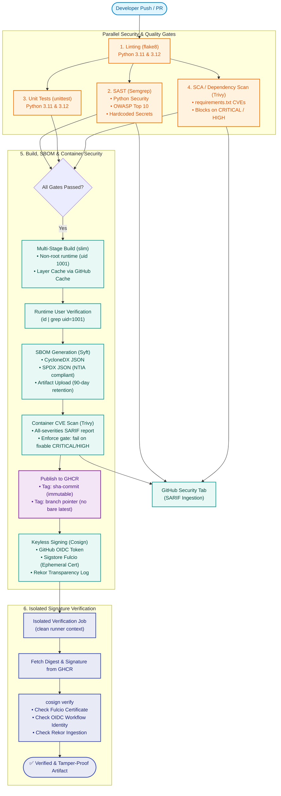

# 🛡️ Secure CI/CD Supply Chain Pipeline

[](https://github.com/wassimselmi/Secure-CICD-supply-chain-pipeline/actions/workflows/ci.yml)
[](#supply-chain-security-gates)
[](#6-keyless-image-signing--signature-verification-cosign)
[](#5-software-bill-of-materials-sbom-syft)

An end-to-end, enterprise-grade **DevSecOps software supply chain pipeline** implementing Zero Trust and Shift-Left principles for containerized microservices. The project demonstrates an automated CI/CD workflow incorporating static application security testing (SAST), software composition analysis (SCA), multi-stage hardened container builds, software bill of materials (SBOM) generation, container vulnerability scanning, immutable SHA-tagged packaging, keyless cryptographic signing via GitHub OIDC, and independent signature attestation.

---

## 📐 Architecture Diagram



---

## 🚪 Security Gates & Pipeline Mechanics

The workflow in [`.github/workflows/ci.yml`](.github/workflows/ci.yml) enforces zero-tolerance quality and security gates at each milestone of the development lifecycle:

### 1. Code Quality & Formatting (`lint`)
* **Tool:** `flake8` across a matrix of **Python 3.11** and **Python 3.12**.
* **Objective:** Detect syntax anomalies, undefined variables, and style deviations before executing test suites or security scanners.
* **Failure Condition:** Any style violation or syntax error terminates the workflow immediately.

### 2. Static Application Security Testing — SAST (`sast`)
* **Tool:** `Semgrep` (pinned version `1.90.0` for deterministic scans).
* **Rule Sets:**
  * `p/python`: Common Python security pitfalls and antipatterns.
  * `p/owasp-top-ten`: Coverage against injection, broken access control, and unsafe configurations.
  * `p/secrets`: Detection of committed credentials, private keys, and API tokens.
* **Dual-Phase Policy:**
  1. **Full Scan (Visibility):** Scans all files and exports results to `semgrep.sarif`, uploaded to the GitHub Security Code Scanning tab via `@v4` actions.
  2. **Enforcement Gate:** Re-evaluates scoped exclusively to `--severity ERROR` with `--error` to halt the build if high-severity flaws are introduced.

### 3. Automated Unit Testing (`test`)
* **Framework:** Standard library `unittest` executing across Python 3.11 and 3.12.
* **Resilience:** Caches pip downloads per OS and Python runtime. Captures test logs as downloadable workflow artifacts upon failure.

### 4. Software Composition Analysis — SCA (`trivy-fs`)
* **Tool:** `Aqua Security Trivy` (`v0.36.0` scanning filesystem dependencies).
* **Scope:** Scans `requirements.txt` and repository manifest locks.
* **Gate Policy:**
  * Flags **CRITICAL** and **HIGH** vulnerabilities.
  * Applies `--ignore-unfixed` to reduce developer fatigue and avoid build failures on unpatchable zero-day advisories.
  * Emits `trivy-fs.sarif` into the repository's security advisory stream.

### 5. Hardened Multi-Stage Build & Non-Root Verification (`build`)
* **Base Image:** `python:3.12-slim` with a multi-stage `Dockerfile`.
  * **Builder Stage:** Compiles and isolates Python wheels under `/install/deps`.
  * **Runtime Stage:** Strips build utilities, compilers, and `pip`. Copies solely the necessary dependencies into `/usr/local`.
* **Least Privilege:** Enforces an unprivileged application user `appuser` (UID: `1001`, GID: `1001`) with no login shell (`/sbin/nologin`).
* **Active Gate:** The pipeline executes `docker run --rm ... id | grep "uid=1001(appuser)"` to prevent regressions where a container might unintentionally execute as `root`.

### 6. Software Bill of Materials — SBOM (`build`)
* **Tool:** `Anchore Syft`.
* **Formats Produced:**
  * **CycloneDX JSON (`sbom.cyclonedx.json`):** Standard for vulnerability tracking platforms (e.g., OWASP Dependency-Track).
  * **SPDX JSON (`sbom.spdx.json`):** Compliant with United States Executive Order 14028 and NTIA minimum elements.
* **Log Visibility:** Prints a formatted summary table directly to the workflow console for instant auditability.
* **Persistence:** Both manifests are retained as build artifacts for **90 days**.

### 7. Container Image Vulnerability Scanning (`build`)
* **Tool:** `Trivy` in container image scanning mode (`scan-type: image`).
* **Gate Policy:**
  * Runs an unblocked all-severities assessment into `trivy-image.sarif` for full dashboard visibility.
  * Runs a blocking enforcement gate (`exit-code: 1`) on fixable `CRITICAL` or `HIGH` vulnerabilities across OS packages and language runtimes.

### 8. Immutable Registry Packaging (`build`)
* **Registry:** GitHub Container Registry (`ghcr.io`).
* **Tagging Strategy:** Managed by `docker/metadata-action`:
  * `sha-<git-commit-hash>`: Permanent, immutable content address.
  * `<branch-name>`: Mutable branch pointer (e.g., `main`, `develop`).
  * 🚫 **No bare `latest` tag:** Prevents ambiguous runtime rollouts.

### 9. Keyless Image Signing with GitHub OIDC (`build`)
* **Tool:** `Sigstore Cosign`.
* **Zero Long-Lived Credentials:** Does not use static private keys or stored repository secrets.
* **Trust Mechanism:**
  1. The GitHub Actions runner requests a short-lived OIDC identity token (`id-token: write`).
  2. Sigstore **Fulcio** verifies the OIDC token claims and issues an ephemeral X.509 code-signing certificate.
  3. The signature and certificate are stamped into the public **Rekor** transparency log.
  4. The signature is pushed to GHCR alongside the container image digest (`@sha256:...`).

### 10. Independent Signature Verification (`verify-signature`)
* **Architecture:** Executed as an isolated job (`needs: build`) on a clean runner environment without access to previous build state.
* **Verification Logic:**
  * Validates the cryptographic signature against the immutable digest.
  * Validates the OIDC issuer (`https://token.actions.githubusercontent.com`).
  * Validates the certificate identity regex against the exact repository and workflow file path:
    ```bash
    cosign verify \
      --certificate-identity-regexp "https://github.com/${{ github.repository }}/.github/workflows/ci.yml@refs/heads/" \
      --certificate-oidc-issuer "https://token.actions.githubusercontent.com" \
      "${REPO}@${DIGEST}"
    ```
  * Ensures that images signed by unauthorized forks, different repositories, or different workflows are rejected.

---

## 🏢 Enterprise Tooling Mapping

In commercial enterprise ecosystems, specialized compliance suites and proprietary platforms often replace or complement open-source tools. Below is an architectural mapping comparing this pipeline's cloud-native stack to industry enterprise solutions:

| Pipeline Capability | Open-Source / Cloud-Native Tool | Enterprise Commercial Equivalents | Key Enterprise Capabilities Added |
| :--- | :--- | :--- | :--- |
| **Static Code Analysis (SAST)** | **Semgrep OSS** | • **SonarQube / SonarCloud Enterprise**<br>• **Checkmarx SAST (CxSAST)**<br>• **Veracode Static Analysis**<br>• **OpenText Fortify** | Centralized policy management, regulatory compliance mapping (PCI-DSS, HIPAA, CWE Top 25), cross-file dataflow analysis, developer training integrations. |
| **Software Composition Analysis (SCA)** | **Trivy (Filesystem)** | • **Sonatype Nexus Lifecycle (IQ Server)**<br>• **Snyk Open Source**<br>• **Synopsys Black Duck**<br>• **Veracode SCA** | Automated license risk legal triage, deep transitive dependency graph inspection, automated fix pull requests, proprietary vulnerability databases. |
| **Container Image Scanning** | **Trivy (Image)** | • **Prisma Cloud (Palo Alto / Twistlock)**<br>• **Aqua Security Enterprise**<br>• **Sysdig Secure**<br>• **Qualys Container Security** | Runtime container threat detection, admission controllers for Kubernetes (OPA/Gatekeeper), CIS benchmark hardening checks, virtual patching. |
| **SBOM Generation & Management** | **Anchore Syft** | • **FOSSA**<br>• **Mend.io (formerly WhiteSource)**<br>• **Anchore Enterprise**<br>• **OWASP Dependency-Track** | Continuous monitoring for new CVEs against static SBOM snapshots, customer-facing SBOM export portals, automated VEX (Vulnerability Exploitability eXchange) generation. |
| **Container & Supply Chain Signing** | **Sigstore Cosign (Keyless / OIDC)** | • **Notation / Notary v2** (CNCF)<br>• **AWS Signer**<br>• **HashiCorp Vault + Transit Secrets**<br>• **Venafi Trust Protection Platform** | Integration with Hardware Security Modules (HSM, FIPS 140-2 Level 3), corporate PKI certificate authorities, enterprise key rotation lifecycles. |
| **Artifact & Image Registry** | **GitHub Container Registry (GHCR)** | • **JFrog Artifactory Enterprise**<br>• **Sonatype Nexus Repository Pro**<br>• **Harbor Enterprise (VMware)**<br>• **AWS ECR / Google Artifact Registry** | Geo-replication, custom retention and quarantine policies, integrated RBAC with corporate Active Directory / Okta, air-gapped deployment support. |
| **CI/CD Orchestration & Identity** | **GitHub Actions + GitHub OIDC** | • **GitLab CI/CD Ultimate**<br>• **Harness.io CI/CD**<br>• **Jenkins Enterprise (CloudBees)**<br>• **Azure DevOps Services** | Fine-grained enterprise governance, audit logging to SIEM (Splunk, Datadog), runner auto-scaling on private cloud infrastructure. |

---

## 📊 Image Size & Security Hardening Comparison

| Image Variant | Base Image | Build Method | Runtime User | Size | Vulnerability Profile |
| :--- | :--- | :--- | :--- | :--- | :--- |
| `secure-api:naive` | `python:3.12` | Single-stage | `root` (UID 0) | **1.12 GB** | High attack surface, full build toolchains, system shells |
| `secure-api:slim` | `python:3.12-slim` | Multi-stage | `appuser` (UID 1001) | **124 MB** | **9× smaller**, minimal attack surface, no compilers, non-root execution |

---

## 🚀 Local Development & Quick Start

### 1. Run Locally

```bash
# Clone the repository
git clone https://github.com/wassimselmi/Secure-CICD-supply-chain-pipeline.git
cd Secure-CICD-supply-chain-pipeline

# Create and activate a virtual environment
python -m venv .venv
# On Windows:
.\.venv\Scripts\activate
# On Linux/macOS:
source .venv/bin/activate

# Install dependencies
pip install -r requirements.txt
pip install -r requirements-lint.txt

# Run linting and unit tests
flake8 app.py test_app.py
python -m unittest test_app -v

# Start the Flask API
python app.py
```

The server is available at `http://localhost:5000`.

### 2. Endpoints

| Method | Route | Description | Example Request |
| :--- | :--- | :--- | :--- |
| `GET` | `/health` | Healthcheck indicator | `curl http://localhost:5000/health` |
| `GET` | `/items` | List items (supports `?category=`) | `curl "http://localhost:5000/items?category=hardware"` |
| `POST` | `/items` | Register new item | `curl -X POST http://localhost:5000/items -H "Content-Type: application/json" -d '{"name": "Sensor", "category": "iot"}'` |

### 3. Build & Run Hardened Container

```bash
# Build the production multi-stage image
docker build -t secure-api:slim .

# Verify the container runs as unprivileged UID 1001
docker run --rm secure-api:slim id

# Run the container
docker run -d -p 5000:5000 --name secure-api secure-api:slim

# Test container health
curl http://localhost:5000/health
```

---

## 🔍 Inspecting SBOMs and Signatures

### Inspecting Downloaded SBOMs
After downloading the `sbom-<sha>` artifact from a workflow run:
```bash
# Inspect package table with Syft
syft sbom:sbom.cyclonedx.json

# Scan the SBOM for known vulnerabilities using Grype
grype sbom:sbom.cyclonedx.json

# Validate SPDX JSON compliance
pip install spdx-tools
pyspdxtools validate sbom.spdx.json
```

Or drag-and-drop `sbom.cyclonedx.json` into the web-based [CycloneDX Web Tool](https://editor.cyclonedx.org/).

### Verifying Cosign Signature Locally
You can verify the authenticity of any pushed image directly from GHCR using Cosign:

```bash
# Set image digest or SHA tag
IMAGE="ghcr.io/wassimselmi/secure-cicd-supply-chain-pipeline@sha256:<IMAGE_DIGEST>"

cosign verify \
  --certificate-identity-regexp "https://github.com/wassimselmi/Secure-CICD-supply-chain-pipeline/.github/workflows/ci.yml@refs/heads/" \
  --certificate-oidc-issuer "https://token.actions.githubusercontent.com" \
  $IMAGE
```

---

## 🛡️ Deliberate Vulnerability Test

To verify that the pipeline active gates function as intended, test vulnerabilities can be introduced on a non-main branch:
* **Dependency SCA Gate Failure:** Introducing a vulnerable package (e.g. `cryptography==38.0.0` with known CRITICAL CVE-2023-23931) in `requirements.txt` immediately halts the `trivy-fs` job.
* **Container Gate Failure:** Downgrading the base image to an EOL release (e.g. `python:3.8-slim`) causes the `Enforce – fail on fixable CRITICAL/HIGH image CVEs` step to terminate the build.
* **Downstream Integrity:** Because `build` and `verify-signature` depend on upstream gates via `needs: [test, sast, trivy-fs]`, no vulnerable image is ever packaged, pushed, or signed.
